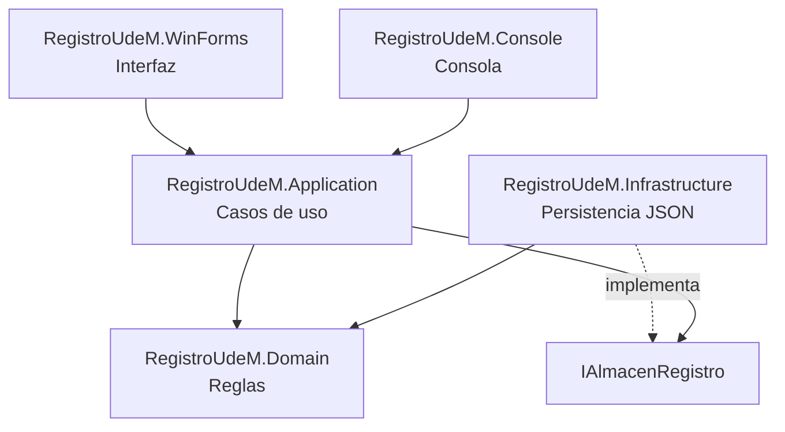

# RegistroUdeM

## Sistema de registro universitario

**Avance del proyecto final**

---

| Campo | Detalle |
|---|---|
| Estudiante | Compañera de clase |
| Carrera | Ingeniería en Sistemas y Computación |
| Asignatura | Programación Orientada a Objetos (FI-134) |
| Tecnología | C# 14 · .NET 10 · Windows Forms · xUnit |

> "Formando profesionales con valores."

---

## Resumen

RegistroUdeM es un avance de sistema para una universidad. Resuelve, mediante programación orientada a objetos, el registro de estudiantes y docentes, carreras y asignaturas, matrículas, calificaciones, pagos, becas y reportes.

La solución se organiza en capas: dominio, aplicación, infraestructura, consola, Windows Forms, laboratorio de la Clase 03 y pruebas. El dominio concentra las reglas; la aplicación orquesta los casos de uso; la infraestructura persiste en JSON.

El diseño aplica herencia, polimorfismo y sobrecarga, e incluye la solución exacta de la Clase 03. Además, se incluye el diseño de base de datos relacional para SQL Server.

---

## 1. Problema

Una universidad necesita ordenar el registro académico y financiero de sus estudiantes: inscripción, calificaciones, pagos, becas y reportes. Cuando esa información está dispersa, aumentan los errores y se pierde trazabilidad.

---

## 2. Objetivos

- Modelar el registro universitario con POO.
- Aplicar herencia, polimorfismo y sobrecarga.
- Implementar casos de uso verificables.
- Persistir datos en JSON.
- Diseñar una base de datos SQL Server.
- Crear interfaz Windows Forms y consola.
- Incluir pruebas automatizadas.

---

## 3. Alcance

### Incluido
- Estudiantes, docentes y administrativos.
- Carreras y asignaturas.
- Matrículas y calificaciones.
- Pagos y becas.
- Reportes académicos y financieros.
- Persistencia JSON.
- Diseño de base de datos.
- Interfaz Windows Forms y consola.

### Fuera de alcance
- Autenticación y roles.
- Integración completa ADO.NET.
- Reportes PDF/Excel.
- Recordatorios.

---

## 4. Arquitectura



---

## 5. POO aplicado

### Herencia
- `Persona` → `Estudiante`, `Docente`, `Administrativo`

### Polimorfismo
- `Persona.Rol` cambia según el tipo.
- `ReporteService` usa las entidades sin preguntar su tipo.

### Sobrecarga
- `RegistrarEstudiante`, `RegistrarCarrera`, etc. se diferencian por parámetros en otros métodos del proyecto.
- El laboratorio incluye sobrecarga exacta de la Clase 03.

---

## 6. Clase 03

Se incluye la solución exacta en `src/RegistroUdeM.Laboratorio/Clase03/`:
- `SeleccionFutbol` → `Futbolista`, `Entrenador`, `Masajista`
- `Forma` → `Circulo`, `Rectangulo`, `Cuadrado`
- `CalculadoraPrecios` con 4 variantes de `Calcular`

---

## 7. Base de datos

Diseño relacional en `docs/bd/`:
- Requisitos.
- Modelo conceptual.
- Modelo lógico.
- Normalización.
- Modelo físico.
- Script SQL Server.
- Diccionario de datos.

Tablas principales:
- `Personas`, `Estudiantes`, `Docentes`, `Administrativos`
- `Carreras`, `Asignaturas`
- `Matriculas`, `Pagos`, `Becas`

---

## 8. Pruebas

```powershell
dotnet build RegistroUdeM.slnx
dotnet test
dotnet run --project src/RegistroUdeM.Console
dotnet run --project src/RegistroUdeM.WinForms
```

---

## 9. Conclusión

El avance presenta una base funcional, documentada y verificable para la entrega final, con POO, interfaz, persistencia y diseño de base de datos.
