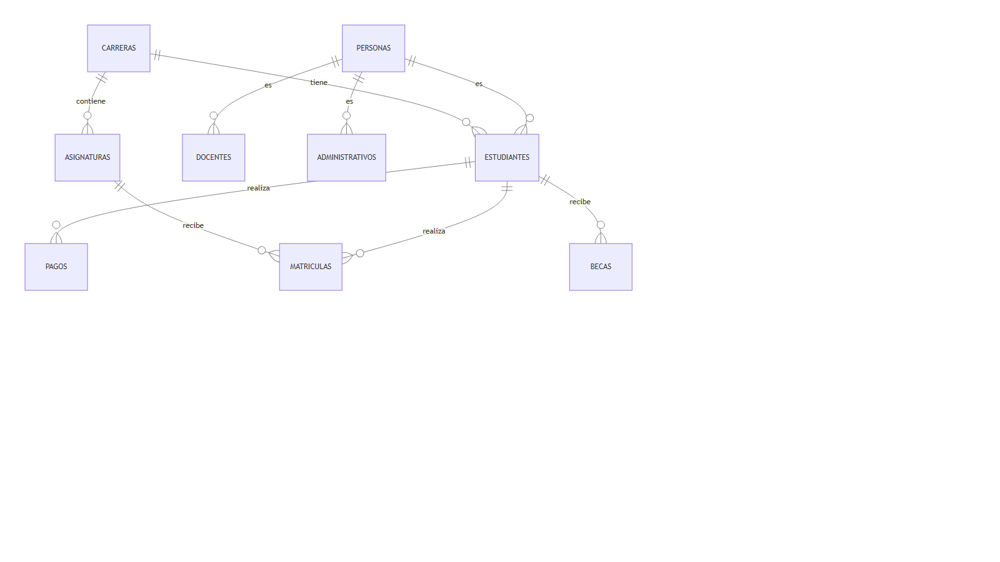
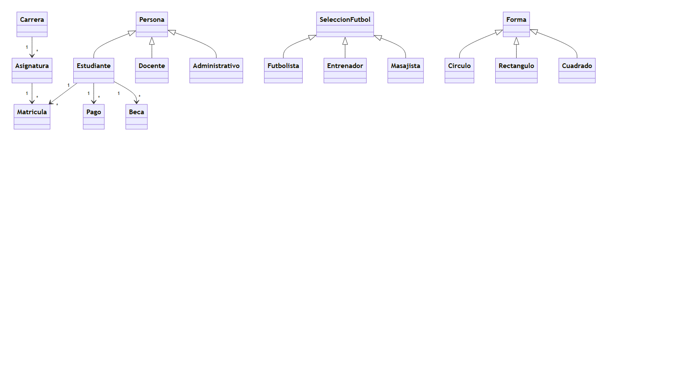
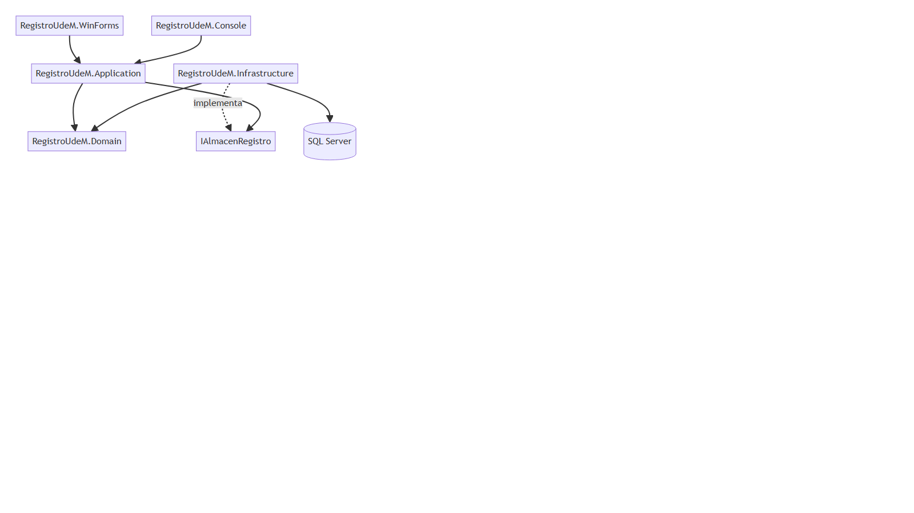

# RegistroUdeM

## Sistema de registro universitario

**Avance del proyecto final**

---

| Campo | Detalle |
|---|---|
| Universidad | Universidad de Managua (UdeM) |
| Docente | ING. Gustavo Acevedo Martínez |
| Estudiante | Julie Bustos |
| Carrera | Ingeniería en computación y telemática |
| Grupo | MI09A |
| Fecha | 30/10/2026 |
| Asignatura | Programación Orientada a Objetos (FI-134) |

> "Formando profesionales con valores."

---

## Resumen

RegistroUdeM es un avance de sistema para la Universidad de Managua. Facilita el registro de estudiantes, docentes y personal administrativo, carreras, asignaturas, matrículas, calificaciones, pagos y becas.

La solución se organiza en capas: dominio, aplicación, infraestructura, consola, Windows Forms, laboratorio de la Clase 03 y pruebas. El dominio concentra las reglas; la aplicación orquesta los casos de uso; la infraestructura persiste en JSON y SQL Server.

El diseño aplica herencia, polimorfismo y sobrecarga, e incluye la solución exacta de la Clase 03. Además, se incluye el diseño de base de datos relacional para SQL Server.

---

# FASE UNO: REQUERIMIENTOS DEL SISTEMA Y ANÁLISIS

## 1. Definir los objetivos y necesidades del sistema

**Objetivo general:** Desarrollar una aplicación de escritorio en C# orientada a la gestión integral del registro universitario, facilitando el control de estudiantes, docentes, carreras, asignaturas, matrículas, calificaciones, pagos y becas para la Universidad de Managua.

**Necesidades del sistema:**
- Automatizar el registro académico y financiero.
- Reducir errores en la inscripción y calificación.
- Evitar pérdida de expedientes.
- Optimizar el tiempo del personal de registro.
- Generar reportes académicos y financieros.

## 2. Identificar los usuarios y sus requerimientos

**Tipo de usuario:** Personal administrativo / registro académico.

**Requerimientos funcionales:**
- Módulo de autenticación: acceso seguro mediante usuario y contraseña.
- Menú principal: navegación fluida a estudiantes, docentes, carreras, asignaturas, matrículas, pagos y becas.
- Gestión de catálogos y registro: registrar, editar, eliminar y consultar estudiantes, docentes, carreras y asignaturas.
- Matrículas: inscribir estudiantes, asignar notas y calcular índice.
- Pagos: registrar pagos y detectar morosos.
- Becas: asignar becas por tipo y porcentaje.
- Reportes: resumen, estudiantes por carrera y mejores índices.

**Requerimientos no funcionales:**
- Plataforma: aplicación de escritorio desarrollada en C# (Windows Forms) orientada a objetos.
- Interfaz: intuitiva, limpia y estandarizada.
- Base de datos: almacenamiento seguro y centralizado en SQL Server.
- Portabilidad: .NET 10.

## 3. Recopilar información sobre los tipos de datos que se almacenan y procesarán

Se recopilaron y estructuraron los catálogos base que el sistema procesará:

- **Estudiantes:** código, nombres, apellidos, documento, teléfono, correo, carrera, fecha de ingreso, estado e índice.
- **Docentes:** código, nombres, apellidos, especialidad, grado académico, teléfono y correo.
- **Administrativos:** código, nombres, apellidos, cargo y departamento.
- **Carreras:** código, nombre, facultad y créditos totales.
- **Asignaturas:** código, nombre, créditos y carrera.
- **Matrículas:** estudiante, asignatura, período, nota, estado y fecha.
- **Pagos:** estudiante, monto, concepto, fecha, estado y referencia.
- **Becas:** estudiante, tipo, porcentaje, estado y observación.

---

# FASE DOS: MODELO CONCEPTUAL

## 4. Modelo conceptual de alto nivel (entidades y atributos)

A partir de los requisitos se identificaron las entidades principales:

- **Persona:** Id, Nombre, Apellido, Documento, Teléfono, Email.
- **Estudiante:** Carnet, Carrera, FechaIngreso, Estado, Índice.
- **Docente:** Especialidad, GradoAcadémico, Activo.
- **Administrativo:** Cargo, Departamento.
- **Carrera:** Código, Nombre, Facultad, CréditosTotales.
- **Asignatura:** Código, Nombre, Créditos, Carrera.
- **Matrícula:** Estudiante, Asignatura, Período, Nota, Estado.
- **Pago:** Estudiante, Monto, Concepto, Fecha, Pagado.
- **Beca:** Estudiante, Tipo, Porcentaje, Activa.

## 5. Relaciones entre entidades

| Relación | Entidades | Cardinalidad | Descripción |
|---|---|---|---|
| Tiene | Carrera - Asignatura | 1 : N | Una carrera tiene varias asignaturas. |
| Pertenece | Estudiante - Carrera | N : 1 | Un estudiante pertenece a una carrera. |
| Realiza | Estudiante - Matrícula | 1 : N | Un estudiante realiza varias matrículas. |
| Recibe | Asignatura - Matrícula | 1 : N | Una asignatura recibe varias matrículas. |
| Realiza | Estudiante - Pago | 1 : N | Un estudiante realiza varios pagos. |
| Recibe | Estudiante - Beca | 1 : N | Un estudiante puede recibir varias becas. |

## 6. Diagrama conceptual



---

# FASE TRES: MODELADO LÓGICO

## 7. Transformación a tablas

Cada entidad se convierte en una tabla y cada atributo en una columna. El identificador principal se convierte en llave primaria (PK). En relaciones 1:N, la PK del lado "1" se coloca como FK en el lado "N".

| Tabla | PK | FK |
|---|---|---|
| Personas | PersonaId | - |
| Estudiantes | EstudianteId | PersonaId, CarreraId |
| Docentes | DocenteId | PersonaId |
| Administrativos | AdministrativoId | PersonaId |
| Carreras | CarreraId | - |
| Asignaturas | AsignaturaId | CarreraId |
| Matriculas | MatriculaId | EstudianteId, AsignaturaId |
| Pagos | PagoId | EstudianteId |
| Becas | BecaId | EstudianteId |

---

# FASE CUATRO: NORMALIZACIÓN

## 8. Normalización

El modelo se encuentra en **1NF, 2NF y 3NF**:

- Los atributos son atómicos.
- No hay grupos repetitivos.
- Las matrículas se guardan en una tabla separada.
- Los datos personales no se repiten en las tablas hijas.
- Los totales y reportes se calculan mediante consultas o vistas.
- Las enumeraciones se validan con restricciones.

Redundancias controladas:
- `TipoPersona` y `Tipo` de beca se usan como discriminadores.
- `Indice` se almacena como saldo académico mutable.

---

# FASE CINCO: DISEÑO FÍSICO

## 9. Modelo físico

Tipos de datos principales:
- `UNIQUEIDENTIFIER` para identificadores.
- `NVARCHAR` para texto.
- `DECIMAL(5,2)` para notas e índices.
- `DECIMAL(12,2)` para montos.
- `DATETIME2(0)` para fechas.
- `BIT` para estados booleanos.

Índices sugeridos:
- `IX_Matriculas_Estudiante`
- `IX_Matriculas_Asignatura`
- `IX_Pagos_Estudiante`
- `IX_Becas_Estudiante`

## 10. Diagrama de clases



## 11. Arquitectura



---

# FASE SEIS: IMPLEMENTACIÓN

## 12. Implementación

El sistema se implementa en C# con arquitectura por capas:
- `RegistroUdeM.Domain`
- `RegistroUdeM.Application`
- `RegistroUdeM.Infrastructure`
- `RegistroUdeM.Console`
- `RegistroUdeM.WinForms`
- `RegistroUdeM.Laboratorio`
- `RegistroUdeM.Tests`

Persistencia:
- JSON local con guardado atómico.
- SQL Server con `SqlAlmacenRegistro` y ADO.NET.

Script SQL:
- `docs/bd/registro_udem.sql`

---

## 13. POO aplicado

### Herencia
- `Persona` → `Estudiante`, `Docente`, `Administrativo`

### Polimorfismo
- `Persona.Rol` cambia según el tipo.
- `ReporteService` usa las entidades sin preguntar su tipo.

### Sobrecarga
- El laboratorio incluye sobrecarga exacta de la Clase 03.
- Los servicios se diferencian por parámetros.

### Encapsulamiento
- `Indice`, `Estado`, `Activa` y validaciones controlan el estado.

---

## 14. Clase 03

Se incluye la solución exacta en `src/RegistroUdeM.Laboratorio/Clase03/`:
- `SeleccionFutbol` → `Futbolista`, `Entrenador`, `Masajista`
- `Forma` → `Circulo`, `Rectangulo`, `Cuadrado`
- `CalculadoraPrecios` con 4 variantes de `Calcular`

---

## 15. Pruebas

```powershell
dotnet build RegistroUdeM.slnx
dotnet test
dotnet run --project src/RegistroUdeM.Console
dotnet run --project src/RegistroUdeM.WinForms
```

---

## 16. Conclusión

El avance presenta una base funcional, documentada y verificable para la entrega final, con POO, interfaz, persistencia y diseño de base de datos.

---

## 17. Anexos

- `README.md`
- `ARQUITECTURA.md`
- `DIAGRAMA_CLASES.md`
- `CLASE_03.md`
- `GUIA_ESTUDIO.md`
- `docs/bd/README.md`
- `docs/bd/registro_udem.sql`
- `docs/AVANCE.docx`
