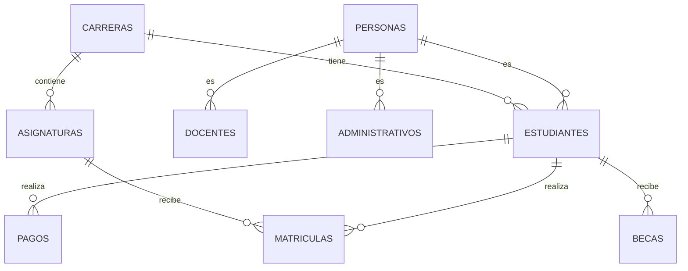

# Diseño de base de datos · RegistroUdeM

## Fases
1. Requisitos.
2. Modelo conceptual.
3. Modelo lógico.
4. Normalización.
5. Modelo físico.
6. Implementación.

## Modelo conceptual (Mermaid)



## Tablas principales
- `Personas`
- `Estudiantes`
- `Docentes`
- `Administrativos`
- `Carreras`
- `Asignaturas`
- `Matriculas`
- `Pagos`
- `Becas`

## Script SQL (resumen)
```sql
CREATE TABLE Personas (...);
CREATE TABLE Estudiantes (...);
CREATE TABLE Carreras (...);
CREATE TABLE Asignaturas (...);
CREATE TABLE Matriculas (...);
CREATE TABLE Pagos (...);
CREATE TABLE Becas (...);
```

La implementación completa puede generarse siguiendo el modelo de HuellaVet adaptado a RegistroUdeM.
